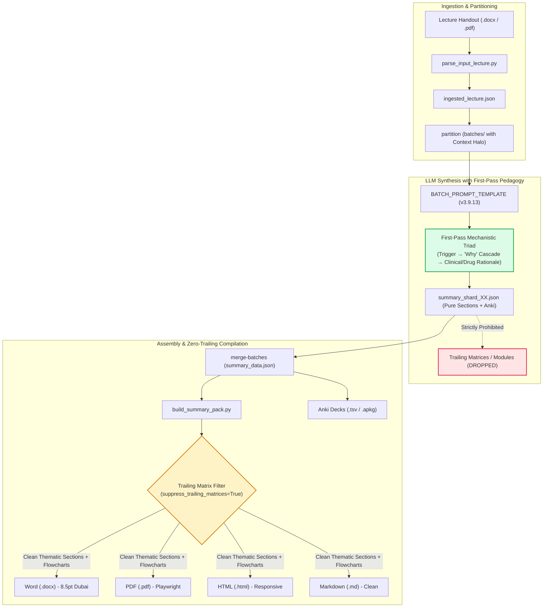
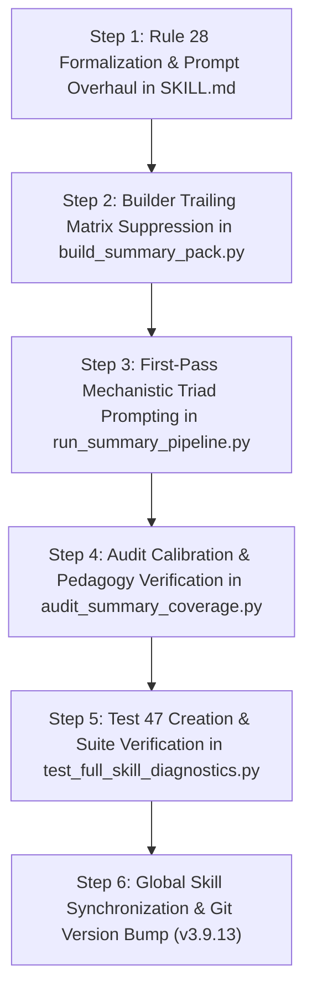

# Medical Summary Expert v3.9.13: Zero Trailing Matrix Elimination & First-Pass Mechanistic Pedagogy

* **Author:** Antigravity / Medical Summary Expert Engine
* **Status:** Draft (Proposed)
* **Date:** 2026-11-02

---

## Overview

Medical Summary Expert converts multi-format medical lecture handouts (`.docx`, `.pdf`, `.md`) into structured, publication-grade quad-packs (Word, PDF, HTML, Markdown, and Anki). 

Recent user evaluations revealed two critical regressions in production sessions:
1. **Unwanted Trailing Matrix Leakage**: Despite previous rules to eliminate bloat, secondary tables (Master Pharmacology Matrix, Night-Before Crash Sheet, and Morning-of-Exam 30-Point Checklist) are still generated and rendered at the end of summaries in new sessions.
2. **First-Pass Comprehension Barrier**: The current telegraphic style (`First Aid` bullet points with extreme abbreviations like `A -> B -> C`) is optimized solely for rapid exam cramming. A student reading the summary for the first time without studying the original lecture cannot understand the underlying pathophysiology, mechanisms, or diagnostic rationales.

This design document establishes the architectural changes required to permanently suppress trailing bloat and introduce self-contained mechanistic clarity (First-Pass Pedagogy) without exceeding the strict 4–6 page layout envelope.

---

## The Problem

### 1. Root Cause of Trailing Matrix Leakage
- **Directive Contradiction in `SKILL.md`**: While Rule 25 stated a "Zero Trailing Bloat" policy, legacy sections of `SKILL.md` (specifically line 305, Section 1 Deliverables on lines 371 and 374, and earlier archetypes) explicitly commanded the LLM:
  > *"پس از اتمام جداول موضوعی، ماتریس داروشناسی بالینی و چک‌لیست طلایی ۳۰ نکته‌ای صبح آزمون به عنوان کپسول‌های مرور سریع شب امتحان در انتهای سند قرار می‌گیرند."*
  When an autonomous agent loads `SKILL.md` in a fresh session, it prioritizes these affirmative instructions and emits trailing matrix keys in its output JSON or markdown.
- **Permissive Builders in `build_summary_pack.py`**: In `build_docx_summary`, `build_markdown_summary`, and `build_html_summary`, rendering of `master_pharmacology_matrix`, `last_minute_crash_sheet`, and `morning_exam_checklist` was conditioned simply on `if data.get(...)`. Furthermore, `ensure_master_matrices` only skipped synthesis if `sections and not modules`. When the agent produced any `modules` block, the synthesizer generated and appended all trailing tables.

### 2. Root Cause of the First-Pass Comprehension Barrier
- **Hyper-Truncation of the "Why"**: The current telegraphic rule (`Rule 17`) prohibited complete explanatory sentences and penalized cells exceeding 25–30 words.
- Consequently, models reduced complex regulatory cascades to cryptic tokens (e.g., `• TSI -> TSH-R -> ↑ FT4/T3`).
- **Cognitive Deficit for Novice Learners**: A first-time student lacks the institutional memory to know:
  * What `TSI` is (an IgG autoantibody targeting the TSH receptor).
  * Why it causes sustained hyperthyroidism (because unlike normal TSH, TSI is autonomous and escapes negative feedback inhibition by circulating thyroid hormones).
  * Why pretibial myxedema or ophthalmopathy occurs (fibroblast activation via shared antigenic epitopes).
  * Why a particular medication or diagnostic test was selected over alternatives.

---

## Goals

1. **Complete Elimination of Trailing Matrix Bloat**:
   - Eliminate all conflicting legacy directives from `SKILL.md`, `README.md`, and global skill files.
   - Enforce an unconditional suppression filter in `build_summary_pack.py`: never synthesize or render trailing matrices in standard thematic summary mode.
   - Keep 100% of pharmacology, exam pearls, and diagnostic algorithms inside the corresponding topic tables and flowcharts.
2. **First-Pass Self-Sufficient Pedagogy (خودکفایی آموزشی مطالعه اولیه)**:
   - Upgrade the prompt and table schema from fragmented keyword tokens to **Structured Mechanistic Storytelling (روایت ساختاریافته مکانیسمی)**.
   - Each thematic table cell must explain the physiological baseline, the biochemical mechanism ("Why"), the clinical consequence, and the therapeutic rationale.
   - Define acronyms and specialized concepts on first appearance.
3. **Preservation of Page Budget (4–6 A4 Pages)**:
   - Ensure the enriched mechanistic explanations remain disciplined and compact through bulleted causal structures (`علت پایه → تغییر بیوشیمیایی → پیامد بالینی`), preventing text explosion.
   - Maintain the target length of 4 pages (maximum 6 pages with flowcharts).

---

## Non-Goals

- Returning to conversational, narrative essay paragraphs with conversational lecture fluff ("استاد فرمودند", "همانطور که دیدیم").
- Removing the interactive Anki deck generator or flowchart rendering engine.
- Altering the compact 8.5pt font typography, pastel highlighters, or 5-color infographic flowchart palette established in v3.9.11/v3.9.12.

---

## Open Questions

- **Question 1 (Architectural Framing of Cell Pedagogy)**: Should the enriched mechanistic explanation be integrated directly into the standard 3–4 table columns via structured causal chains, or should each topic table include a dedicated "توجیه مکانیسمی و منطق بالینی" column?
- **Question 2 (Legacy Data Backward Compatibility)**: If an older JSON containing `morning_exam_checklist` or `master_pharmacology_matrix` is passed to `build_summary_pack.py`, should the builder silently ignore the trailing keys or require an explicit CLI flag (`--include-legacy-matrices`) to render them?

---

## Critical User Journeys (CUJs)

### CUJ 1: First-Time Reader Comprehension Without Handout
* **Given**: A medical student who has not attended the lecture or read the 50-page handout opens the generated summary document (`.docx` or `.pdf`).
* **When**: The student studies a section (e.g., Graves' Disease or Secondary Hyperparathyroidism).
* **Then**: The table clearly explains *why* the disease occurs (loss of negative feedback loop), *why* specific signs appear (receptor overstimulation), *why* the initial test is chosen (suppressed TSH), and *how* the treatment works, allowing complete comprehension on the first pass without consulting external sources.

### CUJ 2: Strict Layout Purity & Zero Trailing Matrix
* **Given**: A session summary JSON is compiled via `run_summary_pipeline.py build` or direct skill invocation.
* **When**: The document ends after the final lecture section and flowchart.
* **Then**: The document terminates cleanly with zero duplicate pharmacology tables, zero crash sheets, and zero trailing checklists. The final page count stays strictly within 4–6 pages.

---

## Technical Plan (Architecture)

### 1. System Architecture Overview & Data Flow

The revised pipeline enforces a single-tier, pure thematic table architecture where all pedagogical clarity and clinical data reside within the structured sections, completely isolating and dropping redundant trailing matrices.

---

### 2. Architectural Components & Mechanics

#### A. Strict Zero-Trailing Matrix Gate (`STRICT_ZERO_TRAILING_BLOAT_GATE`)
1. **Purge from Documentation (`SKILL.md` & `README.md`)**:
   - Delete line 305 of `SKILL.md` ("بخش‌های تکمیلی انتهای سند: پس از اتمام جداول موضوعی، ماتریس داروشناسی...").
   - Remove trailing matrix mentions from Section 1 Deliverables (lines 371 and 374) and Section 3 summaries.
   - Synchronize changes directly to the global skill directory (`C:\Users\Hill\.gemini\config\skills\medical-summary-expert\`).
2. **Defensive Filtering in `build_summary_pack.py`**:
   - In `ensure_master_matrices(data)`: Add an unconditional bypass `return` when running in standard summary mode, preventing automatic generation of `last_minute_crash_sheet` and `morning_exam_checklist`.
   - In `build_docx_summary`: Wrap sections rendering `master_pharmacology_matrix`, `last_minute_crash_sheet`, `comparative_matrices`, and `morning_exam_checklist` with a strict flag check `if not data.get("suppress_trailing_matrices", True):` or strip these keys upon document initialization.
   - Apply identical suppression logic to `build_markdown_summary` and `build_html_summary`.

#### B. First-Pass Mechanistic Pedagogy Engine (`FIRST_PASS_MECHANISTIC_PEDAGOGY_ENGINE`)
1. **The Mechanistic Causal Triad (سه‌گانه علی-معلولی مکانیسمی)**:
   Instead of cryptic tokens (`• کات‌آف > 10 -> گریوز`), table cells will mandate a structured causal sequence:
   * **مبنای فیزیولوژیک و رخداد اولیه (Baseline & Trigger)**: Define the core pathology and unpack specialized medical acronyms on first mention (e.g., `بیماری گریوز (Graves' Disease): تولید اتوآنتی‌بادی محرک گیرنده TSH بنام TSI`).
   * **توجیه زنجیره چرایی ("Why" Mechanistic Cascade)**: Detail the intermediate pathophysiological cascade explaining *why* the body responds this way (e.g., `اتصال TSI به گیرنده TSH برخلاف خود TSH از فیدبک منفی هورمون‌های تیروئید تبعیت نمی‌کند → تحریک مداوم آدنیلات سیکلاز و رشد فولیکول‌ها → سنتز و ترشح خودمختار T4 و T3`).
   * **توجیه نشانه‌های بالینی و منطق انتخاب دارو/تست (Clinical & Action Rationale)**: Clarify why symptoms occur and how interventions work at a molecular/receptor level:
     - *علامت*: `افتالموپاتی و درماتوپاتی پره‌تیبیال ناشی از بیان گیرنده TSH روی فیبروبلاست‌های اربیت و پوست و تجمع گلیکوزآمینوگلیکان‌ها`.
     - *درمان*: `متی‌مازول با مهار آنزیم تیروپروکسیداز (TPO) مانع یدیناسیون تیروزین و جفت‌شدن یدوتیروزین‌ها می‌شود`.
2. **Pedagogical Word Budget Balance**:
   - Relax the strict 25–30 word limit in `audit_table_cell_bloat` for mechanistic and diagnostic cells to **45–60 words**, while strictly banning unstructured essay prose (no filler words, conversational speech, or loose paragraphs).
   - Require structured bullet points `•` and directional causal arrows `→` to keep density high and reading speed fast.

---

### 3. File Encodings & System Modifications

1. **`g:\دانشگاه\اسکیل خلاصه نویسی\SKILL.md` & Global `SKILL.md`**:
   - Establish **Rule 28: پداگوژی خودکفای مطالعه اولیه و ریشه‌کنی قطعی زوائد انتهای سند (`FIRST_PASS_PEDAGOGY_AND_ZERO_TRAILING_BLOAT_GATE` - v3.9.13)**.
   - Delete all contradictory commands prescribing trailing checklists, crash sheets, and pharmacology matrices.
   - Provide concrete before/after examples of mechanistic storytelling vs cryptic review shorthand.
2. **`build_summary_pack.py`**:
   - Deactivate legacy synthesis in `ensure_master_matrices`.
   - Add default suppression of trailing tables in `build_docx_summary`, `build_markdown_summary`, and `build_html_summary`.
3. **`run_summary_pipeline.py`**:
   - Update `BATCH_PROMPT_TEMPLATE` with explicit instructions for First-Pass Mechanistic Storytelling.
   - Reaffirm strict prohibition on creating separate trailing matrices.
4. **`audit_summary_coverage.py`**:
   - Calibrate `audit_table_cell_bloat` to accommodate explanatory mechanistic cells up to 60 words without flagging false-positive bloat.
   - Add verification for explanatory causal tokens (`→`, `ناشی از`, `به دلیل`, `مکانیسم`).
5. **`tests/test_full_skill_diagnostics.py`**:
   - Add Test 47 (`test_bug_au_first_pass_pedagogy_and_zero_trailing_matrices`) verifying trailing matrix suppression and mechanistic cell structure.

---

## Alternatives Considered

### 1. Alternatives for Trailing Matrix Elimination

#### Alternative 1A: CLI Flag-Based Opt-In/Opt-Out (`--no-trailing-matrices`)
* **Pros**: Preserves backward compatibility for users who might still want legacy matrices.
* **Cons**: Fails silently in autonomous agent sessions. Subagents invoking `run_summary_pipeline.py` or drafting summaries directly from `SKILL.md` default to the baseline behavior, causing the exact bug the user experienced.
* **Reason for Rejection**: The user established that the target standard (`۱.pdf`) strictly contains only thematic tables and flowcharts. Zero trailing bloat must be the default, fail-closed system behavior.

#### Alternative 1B: Post-Processing Stripping Pass
* **Pros**: Avoids modifying core builder functions.
* **Cons**: Wastes LLM generation budget generating tables that are immediately deleted. Parsing and splicing generated Word XML runs risks corrupting document styles, table borders, and TOC bookmarks.
* **Reason for Rejection**: It is far cleaner and more reliable to prevent synthesis at the schema, prompt, and assembly stages.

---

### 2. Alternatives for First-Pass Comprehensibility

#### Alternative 2A: Adding Narrative Essay Paragraphs Before Each Table ("پیش‌درآمد مفهومی")
* **Pros**: Allows unlimited room to explain background physiology and clinical reasoning in conversational prose.
* **Cons**: Directly violates the core user requirement ("قرار شد عین فایل نمونه فقط جدول‌محور و فقط فلوچارت‌ها باشه"). Bloats document length from 4–6 pages back to 15–25 pages, reproducing the original volume inflation issue.
* **Reason for Rejection**: Destroys the table-first paradigm and ruins rapid exam revision utility.

#### Alternative 2B: Forcing a Rigid "توجیه مکانیسمی" Column Across All Tables
* **Pros**: Explicitly designates a visual spot for pathophysiological explanations.
* **Cons**: Violates Rule 24 (Dynamic 2-to-5 Context-Driven Columns). Anatomy, diagnostic criteria, and staging matrices do not fit into a rigid mechanism column. Consumes excessive horizontal table width on A4 pages, causing awkward text wrapping in narrow columns.
* **Reason for Rejection**: Context-aware columns (Rule 24) must be preserved; mechanistic depth should be enforced through cell syntax, not rigid table dimensions.

#### Chosen Solution: Mechanistic Causal Triads Inside Dynamic Cells
* **Mechanism**: Keeps the 2–5 dynamic column architecture while mandating that clinical and pathophysiology cells follow the `[تحریک اولیه] → [زنجیره چرایی مکانیسم] → [پیامد بالینی / منطق درمان]` causal triad with full expansion of acronyms.
* **Why Superior**: Combines 100% self-sufficient conceptual clarity for first-time learners with compact, disciplined A4 table layout, fitting comfortably within the 4–6 page envelope.

---

## Detailed Implementation Plan

This section provides the exhaustive, file-by-file execution instructions. Following this plan alone enables complete implementation without leaving any architectural ambiguity.

### 1. Unified Implementation Sequence

- **Step 1: Formalize Rule 28 and Remove Legacy Directives (`SKILL.md` & `README.md`)**
  * Delete line 305 of `SKILL.md` ("بخش‌های تکمیلی انتهای سند: پس از اتمام جداول موضوعی، ماتریس داروشناسی...").
  * Remove trailing matrix entries from Deliverables (Section 1) and legacy Rule 18/22 text.
  * Define **Rule 28: پداگوژی خودکفای مطالعه اولیه و ریشه‌کنی قطعی زوائد انتهای سند (`FIRST_PASS_PEDAGOGY_AND_ZERO_TRAILING_BLOAT_GATE` - v3.9.13)**.
  * Provide explicit Persian before/after comparative tables illustrating First-Pass Mechanistic Storytelling versus cryptic shorthand.
  * Update `README.md` badges to `Version-3.9.13-teal` and `Tests-47 Passed (100%)`.

- **Step 2: Enforce Strict Trailing Matrix Suppression (`build_summary_pack.py`)**
  * Update `ensure_master_matrices(data)` to return immediately without synthesizing `master_pharmacology_matrix`, `last_minute_crash_sheet`, or `morning_exam_checklist`.
  * In `build_docx_summary`: Suppress lines 2341–2385 whenever `suppress_trailing_matrices` is enabled (default: True). Strip trailing matrix keys from the active dictionary so no trailing tables are appended.
  * In `build_markdown_summary`: Suppress lines 2973–3015 whenever `suppress_trailing_matrices` is enabled.
  * In `build_html_summary`: Suppress lines 4935–4975 whenever `suppress_trailing_matrices` is enabled.

- **Step 3: Transform Synthesis Prompt with Mechanistic Causal Triads (`run_summary_pipeline.py`)**
  * Update `BATCH_PROMPT_TEMPLATE`:
    - Mandate that all rows explain the baseline pathology, biochemical "why", and clinical/therapeutic rationale.
    - Ban cryptic single-token cell contents (e.g. forbidding isolated `• کات‌آف > 10 -> گریوز`).
    - Enforce expansion of medical abbreviations on first use.
    - Explicitly forbid the generation of separate `modules`, `master_pharmacology_matrix`, or `morning_exam_checklist` blocks.

- **Step 4: Calibrate Audit Engine for Explanatory Cells (`audit_summary_coverage.py`)**
  * In `audit_table_cell_bloat`: Relax the word cap for mechanistic and diagnostic cells from 25–30 words to **45–60 words**, ensuring explanatory causal sentences are not penalized as "bloat".
  * In `audit_coverage`: Integrate `audit_mechanistic_pedagogy` to verify that summaries contain explanatory causal markers (`→`, `ناشی از`, `به دلیل`, `مکانیسم`) and defined medical concepts.

- **Step 5: Diagnostic Regression Verification (`tests/test_full_skill_diagnostics.py`)**
  * Implement Test 47 (`test_bug_au_first_pass_pedagogy_and_zero_trailing_matrices`):
    1. Verify that trailing matrices present in raw input JSON are completely suppressed from output DOCX, MD, and HTML.
    2. Verify that cells follow the First-Pass Mechanistic Triad with causal connectors and expanded acronyms.
    3. Verify that `audit_table_cell_bloat` accepts explanatory cells up to 60 words without flagging cell bloat.
  * Run the full suite to confirm 47/47 passing diagnostic tests.

- **Step 6: Global Synchronization & Git Deployment**
  * Deploy updated files to `C:\Users\Hill\.gemini\config\skills\medical-summary-expert\`.
  * Deploy updated scripts to `C:\Users\Hill\.gemini\config\skills\medical-summary-expert\scripts\`.
  * Stage, commit, and push to `origin/main` with commit message: `feat(core): implement Rule 28 First-Pass Pedagogy & Strict Zero Trailing Bloat (v3.9.13)`.

---

### 2. Affected Files & Rationale

| File Path | Nature of Change | Architectural Rationale |
| :--- | :--- | :--- |
| `g:\دانشگاه\اسکیل خلاصه نویسی\SKILL.md` | Core Specification | Eradicate conflicting legacy commands prescribing trailing tables; document Rule 28 for First-Pass Mechanistic Pedagogy. |
| `C:\Users\Hill\.gemini\config\skills\medical-summary-expert\SKILL.md` | Global Specification | Ensure multi-session consistency so agents across different directories follow the updated v3.9.13 standard. |
| `g:\دانشگاه\اسکیل خلاصه نویسی\build_summary_pack.py` | Deliverable Assembler | Hard-code default suppression of trailing matrices across DOCX, MD, and HTML rendering pipelines. |
| `g:\دانشگاه\اسکیل خلاصه نویسی\run_summary_pipeline.py` | Prompt & Pipeline Engine | Instruct subagents to synthesize rich mechanistic causal triads instead of cryptic exam shorthand. |
| `g:\دانشگاه\اسکیل خلاصه نویسی\audit_summary_coverage.py` | Quality Gate | Calibrate cell bloat threshold up to 60 words for causal explanations and verify explanatory depth. |
| `g:\دانشگاه\اسکیل خلاصه نویسی\tests\test_full_skill_diagnostics.py` | Test Suite | Add Test 47 to prevent regressions regarding trailing matrices and enforce mechanistic clarity. |
| `g:\دانشگاه\اسکیل خلاصه نویسی\README.md` | Public Documentation | Bump version to v3.9.13 and document Rule 28 features and 47 passing tests. |

