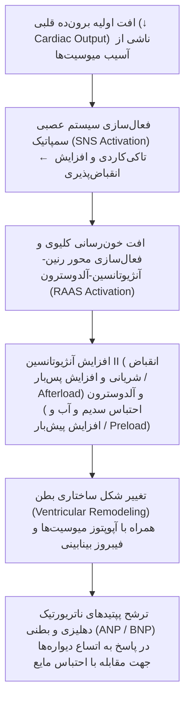

# 🩺 نارسایی احتقانی قلب (Congestive Heart Failure (HF))
> **کورس آموزشی:** قلب و عروق (Cardiovascular System) | **مقطع:** فیزیوپاتولوژی بالینی | **نوع سند:** راهنمای مرور های‌یلد

## ■ نارسایی سیستولیک در برابر دیاستولیک (HFrEF vs HFpEF)

### ۱. تعریف و اتیولوژی (Definition & Etiology)
- نارسایی قلبی (Heart Failure): ناتوانی قلب در پمپاژ کافی خون متناسب با نیازهای متابولیک بافت‌ها یا انجام آن در فشار پرشدگی غیرطبیعی بالا (Elevated Filling Pressures).
- نارسایی سیستولیک (HFrEF - Heart Failure with reduced Ejection Fraction): اختلال در قدرت انقباضی میوکارد (Contractility) با کسر تخلیه‌ای EF ≤ 40%؛ شایع‌ترین علت آن بیماری ایسکمیک قلب (IHD / Post-MI) و کاردیومیوپاتی دیلاته (DCM) است.
- نارسایی دیاستولیک (HFpEF - Heart Failure with preserved Ejection Fraction): اختلال در شل‌شدن بطن و پرشدگی دیاستولیک (Impaired Relaxation & Compliance) با کسر تخلیه‌ای EF ≥ 50%؛ شایع‌ترین علت آن پرفشاری خون مزمن (Chronic HTN) و هایپرتروفی بطن چپ (LVH) در سالمندان است.

### ۲. زنجیره پاتوفیزیولوژی (Pathophysiological Cascade)

- **گام مکانیسمی:** افت اولیه برون‌ده قلبی (↓ Cardiac Output) ناشی از آسیب میوسیت‌ها
- **گام مکانیسمی:** فعال‌سازی سیستم عصبی سمپاتیک (SNS Activation) ← تاکی‌کاردی و افزایش انقباض‌پذیری
- **گام مکانیسمی:** افت خون‌رسانی کلیوی و فعال‌سازی محور رنین-آنژیوتانسین-آلدوسترون (RAAS Activation)
- **گام مکانیسمی:** افزایش آنژیوتانسین II (انقباض شریانی و افزایش پس‌بار / Afterload) و آلدوسترون (احتباس سدیم و آب و افزایش پیش‌بار / Preload)
- **گام مکانیسمی:** تغییر شکل ساختاری بطن (Ventricular Remodeling) همراه با آپوپتوز میوسیت‌ها و فیبروز بینابینی
- **گام مکانیسمی:** ترشح پپتیدهای ناتریورتیک دهلیزی و بطنی (ANP / BNP) در پاسخ به اتساع دیواره‌ها جهت مقابله با احتباس مایع

### ۳. تظاهرات بالینی و ارتباط مکانیسمی (Clinical Presentation)
- **تنگی نفس ارتوپنه و PND (Paroxysmal Nocturnal Dyspnea):** توجیه پاتوفیزیولوژیک ← بازگشت خون وریدی از اندام‌ها به توراکس در حالت خوابیده ← افزایش احتقان مویرگ‌های ریوی (Pulmonary Capillary Wedge Pressure) و خروج مایع به بینابین آلوئول‌ها.
- **صدای سوم قلب (S3 Gallop):** توجیه پاتوفیزیولوژیک ← ورود پرفشار و سریع خون از دهلیز به داخل بطن متسع، پر از مایع و با کمپلیانس ضعیف در ابتدای دیاستول (شاخص کلیدی HFrEF و حجم بیش‌ازحد مایع).
- **صدای چهارم قلب (S4 Gallop):** توجیه پاتوفیزیولوژیک ← انقباض دهلیزی (Atrial Kick) در انتهای دیاستول در برابر یک بطن سفت، ضخیم و غیرمنعطف (شاخص کلیدی HFpEF و LVH شدید).
- **برجستگی ورید ژوگولار (JVD) و هپاتومگالی احتقانی:** توجیه پاتوفیزیولوژیک ← نارسایی عملکرد بطن راست (Right Heart Failure) ← افزایش فشار دهلیز راست (CVP) و پس‌زدگی خون به سیستم وریدی سیستمیک.

### ۴. بررسی‌های تشخیصی (Diagnostic Workup)
- 🔹 **اقدام تشخیصی اولیه (Best Next Step):** اندازه‌گیری پپتید ناتریورتیک مغزی (NT-proBNP / BNP) به همراه نوار قلب (ECG) و رادیوگرافی قفسه سینه (CXR).
- ⭐ **استاندارد طلایی (Gold Standard):** اکوکاردیوگرافی ترنس‌توراسیک (TTE) جهت ارزیابی دقیق کسر تخلیه‌ای (LVEF)، اختلال حرکتی دیواره‌ها و ارزیابی دیاستولیک.
- • سطح سرمی BNP < 100 pg/mL یا NT-proBNP < 300 pg/mL نارسایی حاد قلبی را با ارزش اخباری منفی بالای ۹۸٪ رد می‌کند (Rule-out Test).
- • یافته‌های رادیوگرافی (CXR): خطوط کرل بی (Kerley B lines)، کاردیومگالی (Cardiothoracic Ratio > 0.5) و بازتوزیع عروق به آپکس (Cephalization).

### ۵. اصول فارماکولوژی مبتنی بر مکانیسم (Pharmacology & Rx)
- **مهارکننده‌های سیستم رنین-آنژیوتانسین (ARNI / ACEi):** مکانیسم عمل: مهار بازجذب سدیم و وازوکانستریکشن + مهار تخریب ANP/BNP توسط ساکوبیتریل (Neprilysin Inhibitor) ← کاهش مورتالیتی در HFrEF. (نکته: شروع ACEi با ساکوبیتریل نیازمند ۳۶ ساعت Washout Period است تا ریسک آنژیوادم کشنده پیشگیری شود.)
- **بتابلوکرهای مهارکننده اختصاصی (Carvedilol, Metoprolol Succinate, Bisoprolol):** مکانیسم عمل: محافظت در برابر اثرات سمی کاتکول‌آمین‌های مزمن، کاهش آپوپتوز میوسیت‌ها و مهار تاکی‌کاردی ناشی از سمپاتیک. (نکته: تنها در بیماران همودینامیک پایدار بدون اضافه بار مایع حاد شروع می‌شود (هرگز در فاز نارسایی دکامپانسه حاد شروع یا افزایش دوز داده نشود).)
- **مهارکننده‌های SGLT2 (Dapagliflozin, Empagliflozin):** مکانیسم عمل: مهار ناقل گلوکز-سدیم در لوله پروگزیمال کلیه ← ناتریورز اسموتیک، کاهش پیش‌بار و بهبود متابولیسم انرژی میوکارد (موثر در هر دو HFrEF و HFpEF). (نکته: کاهش مورتالیتی و بستری قلبی مستقل از وجود یا عدم وجود دیابت.)
- **دیورتیک‌های لوپ (Furosemide):** مکانیسم عمل: مهار هم‌انتقال‌دهنده Na⁺-K⁺-2Cl⁻ در قوس صعودی لوله هنله ← تسکین سریع احتقان و علائم بالینی. (نکته: فقط بهبود علامتی ایجاد می‌کنند و اثری در کاهش مورتالیتی قلبی ندارند.)

### ۶. تشخیص افتراقی (Differential Diagnosis Matrix)
| تشخیص بالینی | تظاهرات مشترک | نقطه تمایز کلیدی (Pivot Feature) | تست تاییدی قطعی |
| --- | --- | --- | --- |
| نارسایی سیستولیک (HFrEF) | تنگی نفس ارتوپنه، رال ریوی، ادم | LVEF ≤ 40% همراه با گشاد شدن بطن چپ و صدای S3 | اکوکاردیوگرافی TTE |
| نارسایی دیاستولیک (HFpEF) | تنگی نفس فعالیتی، ادم محیطی | LVEF نرمال (≥50%) همراه با هایپرتروفی دیواره بطن و صدای S4 | اکوکاردیوگرافی داپلر بافتی (E/e') |
| آمبولی حاد ریه (Acute PE) | تنگی نفس حاد، تاکی‌کاردی | شروع هایپراکیوت با درد پلورتیک و اتساع ایزوله بطن راست بدون احتقان LV | سی‌تی آنژیوگرافی عروق ریه (CTPA) |
| حملات حاد COPD | تنگی نفس و ویزینگ شدید | سابقه مصرف سیگار، هیپراینفلیشن در عکس قفسه سینه، BNP نرمال | اسپیرومتری و گازهای خون شریانی (ABG) |

> [!WARNING] **نکات دامی آزمونی و مرواریدهای کلیدی (High-Yield Pearls):**
> - ⚡ صدای S3 یعنی حجم اضافه بار (Volume Overload / Dilated LV)، در حالی که صدای S4 یعنی سفت‌شدن دیواره بطن (Stiff / Non-compliant LV).
> - ⚡ در فاز دکامپانسیون حاد نارسایی قلبی (Wet & Cold)، بتابلوکرها نباید قطع ناگهانی شوند اما هرگز نباید دوز آن‌ها افزایش یابد یا داروی جدید اضافه شود.
> - ⚡ افت سدیم خون (Hyponatremia) در بیماران نارسایی قلبی نشانه فعال‌سازی شدید سیستم نوروهورمونال (RAAS و ADH) و بدترین پیش‌آگهی بلندمدت است.
> - ⚡ دیورتیک‌های لوپ مورتالیتی را کاهش نمی‌دهند؛ تنها داروهای مهارکننده نوروهورمونال (ARNI/ACEi، بتابلوکرها، MRA مثل اسپیرونولاکتون، و SGLT2i) مورتالیتی را کاهش می‌دهند.

> [!IMPORTANT] **⭐ اولویت اول مرور: تأکیدات مستقیم استاد در کلاس:**
> - ⭐ استاد در کلاس تأکید ویژه کرد: در شروع داروی ARNI، رعایت فاصله زمانی ۳۶ ساعت پس از قطع ACEi الزامی است و سؤال قطعی امتحان خواهد بود.
> - ⭐ توجه: دیورتیک‌های لوپ مانند فوروزماید هرگز بقای بیمار را افزایش نمی‌دهند و فقط علامت را بهتر می‌کنند.

> [!CAUTION] **⛔ موارد مصرف ممنوع و خطاهای مرگبار (Absolute Contraindications):**
> - ⛔ شروع یا افزایش دوز بتابلوکر در فاز حاد دکامپانسه نارسایی قلبی (Decompensated HF / Wet & Cold) به دلیل تضعیف انقباض حاد اکیداً ممنوع است.
> - ⛔ تجویز مهارکننده‌های ACE و ARB در تنگی دوطرفه شریان کلیه (Bilateral Renal Artery Stenosis) و در بارداری ممنوع است.
> - ⛔ تجویز همزمان ACEi و مهارکننده نپری‌لیزین (Sacubitril) به دلیل خطر آنژیوادم کشنده ناشی از برادی‌کینین اکیداً کنترااندیکه است (Washout Period الزامی: ۳۶ ساعت).

### 📋 طبقه‌بندی شدت نارسایی قلبی (NYHA Functional Classification)
| کلاس عملکردی | تظاهرات و محدودیت فعالیت بدنی | ارتباط با برون‌ده قلبی |
| --- | --- | --- |
| کلاس I (Class I) | بدون محدودیت در فعالیت بدنی عادی؛ فعالیت روزمره تنگی نفس نمی‌دهد | جبران کامل در استراحت و فعالیت ملایم |
| کلاس II (Class II) | محدودیت خفیف؛ در استراحت راحت است ولی فعالیت عادی تنگی نفس می‌دهد | کاهش ذخیره قلبی در فعالیت‌های معمول |
| کلاس III (Class III) | محدودیت شدید؛ در استراحت راحت است ولی فعالیت کمتر از معمول علامت‌دار است | افزایش فشارهای پرشدگی با کوچکترین جابه‌جایی |
| کلاس IV (Class IV) | ناتوانی کامل؛ وجود علائم نارسایی قلبی حتی در حالت استراحت مطلق | افت شدید برون‌ده قلبی و احتقان دائمی ریوی |

### 📝 خودآزمایی فعال بالینی (Active Recall Clinical Vignettes)
#### سناریوی 1: مرد ۶۵ ساله با تنگی نفس و سابقه انفارکتوس میوکارد
> بیمار آقای ۶۵ ساله با سابقه آنژیوپلاستی عروق کرونری، با شکایت تنگی نفس ارتوپنه و ادم هر دو اندام تحتانی به درمانگاه مراجعه می‌کند. در سمع قلب، صدای سوم قلب (S3) شنیده می‌شود. در اکوکاردیوگرافی، کسر تخلیه‌ای (LVEF) معادل ۳۲٪ گزارش شده است. کدام‌یک از گزینه‌های زیر اقدام درمانی انتخابی جهت کاهش قطعی مورتالیتی درازمدت در این بیمار است؟

- الف) تجویز دیورتیک لوپ با دوز بالا به صورت تک‌دارویی
- ب) شروع مهارکننده سیستم رنین-آنژیوتانسین/نپری‌لیزین (ARNI) همراه با بتابلوکر
- ج) تجویز بلوک‌کننده کانال کلسیم نوع دی‌هیدروپیریدینی (Amlodipine)
- د) تجویز دیگوکسین جهت افزایش مستقیم انقباض‌پذیری بطن

<b>مشاهده پاسخ صحیح و تحلیل فیزیوپاتولوژی</b>

**✓ گزینه (ب): شروع ARNI و بتابلوکر اختصاصی**

*تحلیل فیزیوپاتولوژی:* در نارسایی سیستولیک با کسر تخلیه‌ای کاهش‌یافته (HFrEF)، تنها داروهای مهارکننده محور نوروهورمونال (ARNI/ACEi، بتابلوکرهای کارودیلول/متوپرولول/بیزوپرولول، آنتاگونیست آلدوسترون و SGLT2i) مورتالیتی را کاهش می‌دهند. دیورتیک‌های لوپ صرفاً علائم احتقانی را تسکین می‌دهند و دیگوکسین بقا را بالا نمی‌برد.

## 💊 ماتریس جامع مقایسه داروشناسی بالینی (Master Pharmacology Matrix)

| مبحث / بیماری | دسته دارویی و نمونه‌ها | مکانیسم اثر سلولی | اندیکاسیون دقیق | کنترااندیکاسیون / عوارض مرگبار | نکته کلیدی استاد / دام آزمون |
| --- | --- | --- | --- | --- | --- |
| نارسایی سیستولیک در برابر دیاستولیک | مهارکننده‌های سیستم رنین-آنژیوتانسین (ARNI / ACEi) | مهار بازجذب سدیم و وازوکانستریکشن + مهار تخریب ANP/BNP توسط ساکوبیتریل (Neprilysin Inhibitor) ← کاهش مورتالیتی در HFrEF. | - | - | شروع ACEi با ساکوبیتریل نیازمند ۳۶ ساعت Washout Period است تا ریسک آنژیوادم کشنده پیشگیری شود. |
| نارسایی سیستولیک در برابر دیاستولیک | بتابلوکرهای مهارکننده اختصاصی (Carvedilol, Metoprolol Succinate, Bisoprolol) | محافظت در برابر اثرات سمی کاتکول‌آمین‌های مزمن، کاهش آپوپتوز میوسیت‌ها و مهار تاکی‌کاردی ناشی از سمپاتیک. | - | - | تنها در بیماران همودینامیک پایدار بدون اضافه بار مایع حاد شروع می‌شود (هرگز در فاز نارسایی دکامپانسه حاد شروع یا افزایش دوز داده نشود). |
| نارسایی سیستولیک در برابر دیاستولیک | مهارکننده‌های SGLT2 (Dapagliflozin, Empagliflozin) | مهار ناقل گلوکز-سدیم در لوله پروگزیمال کلیه ← ناتریورز اسموتیک، کاهش پیش‌بار و بهبود متابولیسم انرژی میوکارد (موثر در هر دو HFrEF و HFpEF). | - | - | کاهش مورتالیتی و بستری قلبی مستقل از وجود یا عدم وجود دیابت. |
| نارسایی سیستولیک در برابر دیاستولیک | دیورتیک‌های لوپ (Furosemide) | مهار هم‌انتقال‌دهنده Na⁺-K⁺-2Cl⁻ در قوس صعودی لوله هنله ← تسکین سریع احتقان و علائم بالینی. | - | - | فقط بهبود علامتی ایجاد می‌کنند و اثری در کاهش مورتالیتی قلبی ندارند. |

## 🚀 کپسول طلایی شب امتحان (Last-Minute High-Yield Cheat Sheet)
| بیماری | اتیولوژی اصلی | مکانیسم پاتوفیزیولوژی کلیدی | علامت شاخص / تریاد | اقدام تشخیصی نخستین | درمان انتخابی |
| --- | --- | --- | --- | --- | --- |
| نارسایی سیستولیک (HFrEF) | ایسکمی قلبی (IHD) و دیلاته | افت انقباضی میوکارد ← افت CO ← فعال‌سازی سمپاتیک و RAAS | تنگی نفس ارتوپنه + صدای S3 + وریدهای ژوگولار متسع | BNP و اکوکاردیوگرافی TTE (EF ≤ 40%) | چهارگانه طلایی: ARNI + بتابلوکر + MRA + SGLT2i |
| نارسایی دیاستولیک (HFpEF) | پرفشاری خون مزمن در سالمندان | کاهش کمپلیانس و شل‌شدن دیاستولیک ← افزایش فشارهای پرشدگی | تنگی نفس فعالیتی + صدای S4 + فشارخون بالا | اکوکاردیوگرافی داپلر بافتی (EF ≥ 50%) | مهارکننده‌های SGLT2 + کنترل فشارخون و دیورتیک |
